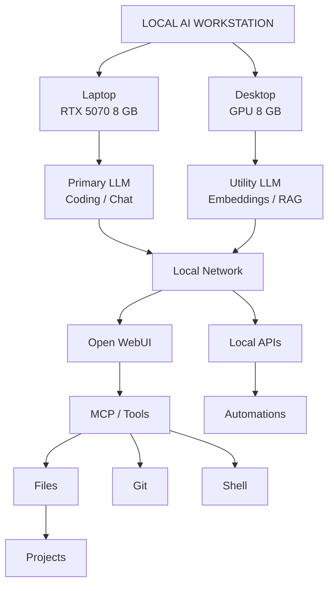

# Local AI Workstation

Local AI infrastructure for working with LLMs, RAG, MCP, coding agents, and automation.

The main goal of this project is not simply to run local AI models, but to build a self-hosted AI environment on personal hardware that supports and assists with the development and management of other projects.

## Hardware

### Laptop
- CPU: AMD Ryzen 9 8940HX with Radeon Graphics
- RAM: 32 GB
- GPU: NVIDIA GeForce RTX 5070 Laptop GPU
- VRAM: 8 GB
- SSD free space at project start: ~300 GB

### Desktop
Характеристики будут добавлены после проверки.

Планируемая роль: второй AI node для отдельной модели, embeddings, RAG или фоновых задач.

## Current software

- Windows
- LM Studio
- Git
- GitHub repository configured (`origin`)

## Current model benchmarks

| Model | Quantization | Approx. speed | Notes |
|---|---|---:|---|
| Gemma 4 E4B QAT | QAT | ~52 tok/s | Very fast, answer quality less preferred |
| Qwen3-14B | Q4_K_M | ~8.5 tok/s | Current quality/speed baseline |
| Qwen3.8-27B | Q4 | ~0.7 tok/s | Works, but too slow interactively |
| Qwen3.5-9B | TBD | ~43–45 tok/s | Core T01–T05 recorded; quality scoring and runtime metadata still pending |

## Target architecture



## Roadmap

### v0.1 — Local inference
- [x] Install LM Studio
- [x] Validate NVIDIA GPU inference
- [x] Benchmark Gemma 4 E4B
- [x] Benchmark Qwen3-14B Q4_K_M
- [x] Benchmark Qwen3.8-27B Q4
- [x] Run Qwen3.5-9B Core Benchmark (T01–T05)
- [ ] Complete Qwen3.5-9B benchmark metadata and quality scoring
- [ ] Compare Qwen3.5-9B with Qwen3-14B using identical prompts
- [ ] Select primary daily model

### v0.2 — Local API
- [ ] Enable LM Studio local API
- [ ] Test OpenAI-compatible endpoint
- [ ] Add simple API health-check script
- [ ] Test model calls from Python

### v0.3 — Unified UI
- [ ] Install Open WebUI
- [ ] Connect Open WebUI to LM Studio
- [ ] Create General / Coding / Project assistants

### v0.4 — Tools
- [ ] Add trusted filesystem MCP
- [ ] Add Git tooling
- [ ] Add shell/Python tools with restricted permissions
- [ ] Test against a real local project

### v0.5 — Knowledge / RAG
- [ ] Select embedding model
- [ ] Decide vector store
- [ ] Add project documentation knowledge base
- [ ] Benchmark retrieval quality

### v0.6 — Second AI node
- [ ] Record desktop hardware
- [ ] Benchmark desktop GPU
- [ ] Assign node role
- [ ] Connect both machines over LAN
- [ ] Test independent parallel workloads

### v0.7 — Automation
- [ ] Evaluate n8n
- [ ] Add local LLM workflows
- [ ] Add recurring project-support automations

### v0.8 — Agents
- [ ] Start with one agent + tools
- [ ] Add planning loop only where useful
- [ ] Evaluate multi-agent workflows only after single-agent baseline

## Design principles

1. **Useful before impressive.**
2. Prefer one good agent with reliable tools over many agents talking to each other.
3. Keep sensitive/private project data local when possible.
4. Benchmark on actual hardware instead of relying only on leaderboards.
5. Optimize for answer quality at acceptable speed, not tokens/sec alone.
6. Do not give tools unrestricted filesystem or shell access by default.
7. Keep configuration reproducible and version-controlled.
8. Do not commit model weights, caches, secrets or generated vector databases to GitHub.

## Repository layout

```text
local-ai-workstation/
├── README.md
├── PROJECT.md
├── .gitignore
├── configs/
├── scripts/
├── benchmarks/
├── docs/
├── knowledge/
└── notes/
```

## GitHub repository

The repository is already connected to GitHub through the `origin` remote.

Normal workflow:

```powershell
git add .
git commit -m "Describe change"
git push
```

Do not commit API keys, tokens, `.env` files, model files or caches.
